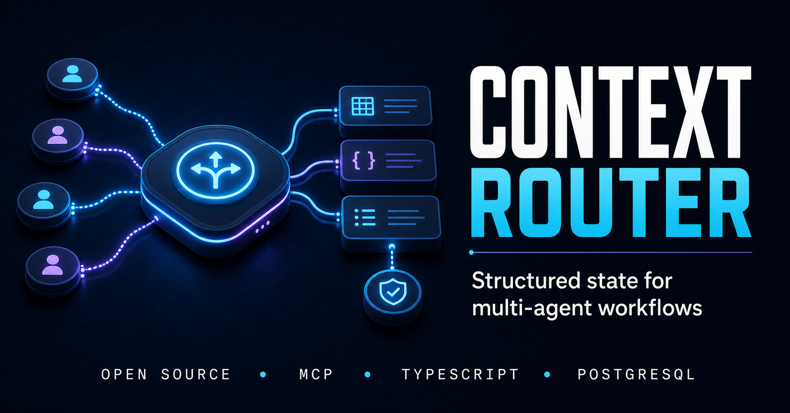

<p align="center">
  
</p>

<h1 align="center">Context Router</h1>

<p align="center">
  <strong>Clean state in. Focused context out.</strong>
</p>

<p align="center">
  A local MCP server that gives multi-agent workflows structured state,
  schema validation, selective reads, durable checkpoints, and concise handoffs.
</p>

<p align="center">
  <a href="./LICENSE"></a>
  
  <a href="https://www.npmjs.com/package/@context-router/sdk"></a>
  <a href="https://pypi.org/project/ctxrouter/"></a>
  
  
  
</p>

---

## The problem

Multi-agent systems often pass entire chat histories from one agent to the
next. That means every downstream agent inherits:

- irrelevant reasoning and dead ends;
- contradictory intermediate answers;
- larger prompts and repeated token costs;
- no durable recovery point when a step fails.

Context Router replaces that growing conversation chain with a small,
purpose-built state layer.

| Without Context Router        | With Context Router                   |
| ----------------------------- | ------------------------------------- |
| Pass complete chat histories  | Pass only validated state             |
| Every agent sees everything   | Agents read only the keys they need   |
| Failures restart the pipeline | Checkpoints preserve completed work   |
| Context grows at every step   | Handoffs remain concise and bounded   |
| State shape is implicit       | Schemas make state contracts explicit |

## Efficiency Proof

Run benchmarks to see the impact: `npm run bench:all`

| Metric               | Traditional    | Context Router  | Improvement          |
| -------------------- | -------------- | --------------- | -------------------- |
| **Token Usage**      | 100%           | 15-30%          | **70-85% reduction** |
| **Memory**           | 100%           | 2-5%            | **20-50x smaller**   |
| **API Costs**        | $5.25/workflow | $2.34/workflow  | **55% savings**      |
| **Failure Recovery** | Full restart   | Instant restore | **10x faster**       |

### Benchmark Results

**Token Reduction** (72% average):

```
| Scenario          | Traditional | Context Router | Reduction |
|-------------------|-------------|----------------|-----------|
| Simple (3 rounds) |       1,630 |            471 |      71.1% |
| Medium (5 rounds) |       2,689 |            753 |      72.0% |
| Complex (10 rounds) |       5,334 |          1,458 |      72.7% |
```

**Memory Savings** (20-50x smaller):

```
| Scenario                  | Chat History | Context Router | Savings |
|---------------------------|--------------|----------------|---------|
| Small (2 agents, 5 msgs)  |       0.01MB |          0.00MB |  11.0x |
| Medium (5 agents, 10 msgs)|       0.05MB |          0.00MB |  24.3x |
| Large (10 agents, 20 msgs)|       0.20MB |          0.00MB |  50.6x |
```

**Cost Savings** ($34K/year for large teams):

```
| Team Size | Monthly Savings | Yearly Savings | ROI |
|-----------|----------------|---------------|-----|
| Small     | $42            | $507          | -10%|
| Medium    | $78            | $940          | 19% |
| Large     | $2,860         | $34,320       | 686%|
```

## How it works

```text
 Agent A                  Context Router                  Agent B
┌─────────┐              ┌────────────────┐             ┌─────────┐
│ Reason  │──write──────▶│ Structured     │──select────▶│ Reason  │
│ & act   │              │ workflow state │             │ & act   │
└─────────┘              │                │             └─────────┘
                         │  ✓ schemas     │
                         │  ✓ versions    │
                         │  ✓ checkpoints │
                         │  ✓ handoffs    │
                         └───────┬────────┘
                                 │
                                 ▼
                       SQLite / PostgreSQL
```

Context Router does **not** execute or orchestrate agents. It gives any
MCP-compatible agent system a reliable place to exchange workflow state.

## What you get

- **37 MCP tools** across workspaces, schemas, workflows, state, checkpoints,
  handoffs, step execution, and agent roles
- **Schema-enforced state** with nested objects, arrays, enums, and required fields
- **Selective context reads** so each agent receives only relevant state keys
- **Explicit workflow lifecycles** with running, completed, and failed states
- **Visible state versions** on every update
- **Transactional restores** that apply checkpoint snapshots atomically
- **Bounded handoff summaries** generated from selected or complete workflow state
- **Workspace-scoped persistence** for safe local project separation
- **TypeScript SDK** with a simple workflow session and the full explicit API
- **Python SDK** (`ctxrouter` v0.6.0) with the same workflow session and MCP tool surface
- **Cursor MCP** via `@context-router/mcp-server` for multi-agent Agent chats
- **Zero-configuration local runtime** with SQLite by default and PostgreSQL for production

## How to use this project

| Path                                      | Doc                                          |
| ----------------------------------------- | -------------------------------------------- |
| **Full guide (Cursor + Python cookbook)** | **[USING.md](USING.md)**                     |
| TypeScript quickstart                     | below                                        |
| Cursor MCP only                           | [docs/cursor-setup.md](docs/cursor-setup.md) |
| MCP tool reference                        | [docs/api.md](docs/api.md)                   |

## Quickstart

You need Node.js 20 or newer. No database, Docker installation, migration, or
environment file is required.

### TypeScript

```bash
npm install @context-router/sdk
```

```typescript
import { ContextRouter } from '@context-router/sdk';

const router = await ContextRouter.local();
const flow = await router.start('Research');
await flow.set('findings', { answer: 42, source: 'example' });
console.log((await flow.handoff({ keys: ['findings'] })).summary);
await flow.complete();
await router.close();
```

### Python

```bash
npm install @context-router/mcp-server   # Node MCP server the SDK spawns
pip install ctxrouter                    # PyPI name; imported as context_router
```

```python
import asyncio
from context_router import ContextRouter


async def main():
    async with await ContextRouter.local() as router:
        flow = await router.start('Research')
        await flow.set('findings', {'answer': 42, 'source': 'example'})
        print((await flow.handoff(keys=['findings'])).summary)
        await flow.complete()


asyncio.run(main())
```

### Cursor MCP (`@context-router`)

```json
{
  "mcpServers": {
    "context-router": {
      "command": "npx",
      "args": ["-y", "@context-router/mcp-server"]
    }
  }
}
```

Then attach **`@context-router`** in Agent and use tools like `workspace_ensure`,
`state_write`, and `handoff_generate` instead of pasting full chat history.
See [USING.md](USING.md) for the full Cursor cookbook.

SQLite is created automatically in your operating system's application-data
directory. Inspect the resolved location and installation health at any time:

```bash
npx context-router doctor
npx context-router status
```

Context Router stores and transfers workflow state. It does not execute agents.

## Start here

Pick the workflow pattern that matches your use case:

| Pattern                     | Guide                                                                          | Example                                                                                                     |
| --------------------------- | ------------------------------------------------------------------------------ | ----------------------------------------------------------------------------------------------------------- |
| Linear agent chain          | [docs/workflows/simple-pipeline.md](docs/workflows/simple-pipeline.md)         | `node scripts/run-example.mjs simple-pipeline` · [examples/simple-pipeline.py](examples/simple-pipeline.py) |
| Parallel fan-out + merge    | [docs/workflows/parallel-merge.md](docs/workflows/parallel-merge.md)           | `node scripts/run-example.mjs parallel-merge`                                                               |
| Checkpoint retry / recovery | [docs/workflows/retry-recovery.md](docs/workflows/retry-recovery.md)           | `node scripts/run-example.mjs retry-recovery`                                                               |
| Multi-agent orchestrator    | [examples/multi-agent-orchestrator.ts](examples/multi-agent-orchestrator.ts)   | `node scripts/run-example.mjs multi-agent-orchestrator`                                                     |
| Human-in-the-loop review    | [examples/human-in-the-loop.ts](examples/human-in-the-loop.ts)                 | `node scripts/run-example.mjs human-in-the-loop`                                                            |
| Content generation pipeline | [examples/content-pipeline.ts](examples/content-pipeline.ts)                   | `node scripts/run-example.mjs content-pipeline`                                                             |
| LangGraph integration       | [examples/langgraph-example.ts](examples/langgraph-example.ts)                 | `node scripts/run-example.mjs langgraph`                                                                    |
| LlamaIndex semantic search  | [packages/llamaindex-adapter/README.md](packages/llamaindex-adapter/README.md) | Vector search over workflow state                                                                           |
| Cursor + Python cookbook    | [USING.md](USING.md)                                                           | recipes for MCP + `context_router`                                                                          |

The recommended SDK entry point is `ContextRouter.local()` and `router.start()` — you do not need to learn all 37 MCP tools to get started.

## Runnable examples

Requires Node.js 20+ and a built SDK (`npm run build` from this repository).

### Simple Pipeline

[examples/simple-pipeline.ts](examples/simple-pipeline.ts) — Linear agent chain

```bash
node scripts/run-example.mjs simple-pipeline
```

### Parallel Merge

[examples/parallel-merge.ts](examples/parallel-merge.ts) — Fan-out to multiple agents, merge results

```bash
node scripts/run-example.mjs parallel-merge
```

### Retry Recovery

[examples/retry-recovery.ts](examples/retry-recovery.ts) — Checkpoint-based retry with state restoration

```bash
node scripts/run-example.mjs retry-recovery
```

### Multi-Agent Orchestrator

[examples/multi-agent-orchestrator.ts](examples/multi-agent-orchestrator.ts) — Coordinator pattern with conditional branching

```bash
node scripts/run-example.mjs multi-agent-orchestrator
```

### Human-in-the-Loop

[examples/human-in-the-loop.ts](examples/human-in-the-loop.ts) — Approval workflows with revision loops

```bash
AUTO_APPROVE=true node scripts/run-example.mjs human-in-the-loop
```

### Content Pipeline

[examples/content-pipeline.ts](examples/content-pipeline.ts) — Multi-stage content generation with social variants

```bash
node scripts/run-example.mjs content-pipeline
```

### LangGraph Integration

[examples/langgraph-example.ts](examples/langgraph-example.ts) — Using Context Router with LangGraph workflows

```bash
node scripts/run-example.mjs langgraph
```

You can also run an example directly with `node --experimental-strip-types examples/simple-pipeline.ts`.

## Connect an MCP client

To use the raw MCP surface instead of the SDK, add the server to a client that
supports local stdio MCP servers (including **Cursor**). SQLite remains the default:

```json
{
  "mcpServers": {
    "context-router": {
      "command": "npx",
      "args": ["-y", "@context-router/mcp-server"]
    }
  }
}
```

For PostgreSQL, set `DATABASE_URL`, run the included Prisma migrations, and then
start the server. `CONTEXT_ROUTER_OWNER_ID` is a trusted-local isolation scope,
not a remote authentication credential.

Full Cursor Agent patterns and recipes: [USING.md](USING.md). Short setup:
[docs/cursor-setup.md](docs/cursor-setup.md).

## The workflow lifecycle

```text
workspace_ensure / workspace_create
  -> schema_create (optional)
  -> workflow_create
  -> state_write
  -> checkpoint_create
  -> state_read / handoff_generate
  -> checkpoint_restore (when needed)
  -> workflow_complete
```

### Explicit TypeScript SDK

```typescript
import { ContextRouter } from '@context-router/sdk';

const router = await ContextRouter.local();

const workspace = await router.workspace.create('Lead qualification');

await router.schema.create(workspace.id, 'Lead', {
  companyName: { type: 'string', required: true },
  domain: { type: 'string', required: true },
  status: {
    type: 'enum',
    values: ['PENDING', 'CONFIRMED', 'REJECTED'],
    required: true,
  },
});

const workflow = await router.workflow.create(workspace.id);

await router.state.write(
  workspace.id,
  workflow.id,
  'lead',
  {
    companyName: 'Acme Corp',
    domain: 'acme.example',
    status: 'CONFIRMED',
  },
  { schemaName: 'Lead' },
);

await router.checkpoint.create(workspace.id, workflow.id, {
  label: 'validated-lead',
});

const handoff = await router.handoff.generate(workspace.id, workflow.id, {
  keys: ['lead'],
  maxTokens: 100,
});

console.log(handoff.summary);

await router.workflow.complete(workspace.id, workflow.id);
await router.disconnect();
```

See the complete
[lead qualification example](examples/lead-qualification.ts).

## MCP tool surface

<details>
<summary><strong>View all 37 tools</strong></summary>

| Area       | Tools                                                                                               |
| ---------- | --------------------------------------------------------------------------------------------------- |
| Router     | `router_status`                                                                                     |
| Workspace  | `workspace_create`, `workspace_ensure`, `workspace_list`, `workspace_get`, `workspace_delete`       |
| Schema     | `schema_create`, `schema_get`, `schema_list`, `schema_validate`, `schema_migrate`, `schema_diff`    |
| Workflow   | `workflow_create`, `workflow_status`, `workflow_complete`, `workflow_fail`                          |
| State      | `state_write`, `state_read`, `state_delete`, `state_snapshot`, `state_diff`, `state_delete_expired` |
| Checkpoint | `checkpoint_create`, `checkpoint_list`, `checkpoint_restore`, `checkpoint_delete`                   |
| Handoff    | `handoff_generate`, `handoff_generate_ai`, `handoff_apply`                                          |
| Step       | `step_run_start`, `step_run_complete`, `step_run_fail`                                              |
| Journal    | `journal_query`, `journal_append`                                                                   |
| Agent role | `agent_role_create`, `agent_role_list`                                                              |
| Debugger   | `debugger_inspect` (list/inspect/diff/tail workflows)                                               |

Batch writes, TTL, and the journal's replay, stats, and export views are options
on these tools, not separate tools: `state_write` takes `entries` or
`expiresIn`, `state_read` takes `keys`, `state_diff` takes `mode`,
`journal_query` takes `view`, and `schema_migrate` takes `dryRun`.

Every tool returns one stable JSON envelope:

```json
{ "success": true, "data": {} }
```

```json
{
  "success": false,
  "error": {
    "code": "WORKFLOW_NOT_FOUND",
    "message": "Workflow was not found in the workspace"
  }
}
```

</details>

Read the complete [MCP API reference](docs/api.md).

## Project structure

```text
context-router/
├── USING.md              # Cursor + Python usage guide (start here for adopters)
├── packages/
│   ├── server/           # MCP server (@context-router/mcp-server), tools, Prisma
│   ├── sdk-typescript/   # TypeScript SDK (@context-router/sdk)
│   ├── sdk-python/       # Python SDK (ctxrouter on PyPI)
│   ├── langgraph-adapter/  # LangGraph checkpointer adapter
│   ├── crewai-adapter/     # CREWAI memory adapter
│   ├── autogen-adapter/    # AutoGen session and group-chat adapter
│   └── llamaindex-adapter/ # LlamaIndex semantic search over workflow state
├── examples/             # TypeScript + Python end-to-end examples
├── docs/                 # Architecture, API, Cursor setup, workflows, publishing
├── scripts/              # MCP smoke checks, example runners, publish scripts
└── docker-compose.yml    # Optional local PostgreSQL 16
```

## Current status

Context Router is an **early open-source preview**. The npm packages are
published at **v0.5.0** and the Python SDK (`ctxrouter`) at **v0.6.0**. The
v0.6.0 npm release is prepared in this repository but not yet published, so this
README can be ahead of what `npm install` gives you.

Already working:

- TypeScript build and type-checking
- unit and SDK contract tests (259 tests passing)
- MCP discovery smoke test for all 37 tools
- SQLite and PostgreSQL integration test suites
- clean npm package generation (`@context-router/mcp-server`, `@context-router/sdk`)
- Python SDK with MCP stdio transport and TypeScript API parity
- zero-config Cursor MCP via `npx @context-router/mcp-server`
- LangGraph, CREWAI, AutoGen, and LlamaIndex adapter packages
- Event Journal — full audit trail with replay capability
- AI-powered handoffs with natural language summaries
- Batch operations for efficient state reads/writes
- State TTL support for automatic data expiration
- Schema migration tools for evolving data models
- State diff tools for comparing checkpoints
- Visual workflow debugger (`debugger_inspect` tool)
- OpenTelemetry-ready observability layer
- Improved error messages with actionable suggestions

Deliberately outside the current preview:

- remote MCP transport;
- hosted authentication and multi-tenancy;
- billing or managed infrastructure;
- automatic agent execution (Context Router records steps but does not invoke agents).

Please do not expose the stdio server directly to an untrusted network.

## Roadmap

- **v0.1:** trusted-local MCP server, PostgreSQL storage, TypeScript SDK
- **v0.2:** CAS writes, step execution, agent roles, provenance, structured handoffs
- **v0.3:** SQLite default, Node 20+, local workflow SDK, doctor/status CLI
- **v0.3.1 / Python 0.4.0:** workflow guides, Python SDK, Cursor zero-config docs
- **v0.4.0:** LangGraph/CREWAI adapters, workflow debugger, improved error messages
- **v0.5.0:** AutoGen adapter + coordinated npm/Python 0.5.0 publish line
- **v0.6.0 (Python SDK published; npm release pending):** Event Journal, AI Handoffs, LlamaIndex adapter, Operational tools (batch ops, TTL, schema migration, state diff), tool surface consolidated to 37
- **Later evaluation:** remote MCP transport, hosted authentication, observability, hosted deployment, automatic agent execution

See the detailed [roadmap](docs/roadmap.md).

## Contributing

Issues, documentation improvements, examples, tests, and focused pull requests
are welcome. Start with [CONTRIBUTING.md](CONTRIBUTING.md) and review the
[Code of Conduct](CODE_OF_CONDUCT.md).

If you find a security issue, follow [SECURITY.md](SECURITY.md) instead of
opening a public issue.

## Documentation

- **[USING.md](USING.md) — Cursor (`@context-router`) + Python cookbook**
- [Cursor setup](docs/cursor-setup.md)
- [Architecture](docs/architecture.md)
- [MCP tool API](docs/api.md)
- [Workflow patterns](docs/workflows/simple-pipeline.md)
- [LangGraph adapter](packages/langgraph-adapter/README.md)
- [CREWAI adapter](packages/crewai-adapter/README.md)
- [AutoGen adapter](packages/autogen-adapter/README.md)
- [LlamaIndex adapter](packages/llamaindex-adapter/README.md)
- [Publishing guide](docs/publishing.md)
- [Roadmap](docs/roadmap.md)
- [Release checklist](docs/release-checklist.md)
- [Changelog](CHANGELOG.md)

## License

Context Router is available under the
[Apache License 2.0](LICENSE).

---

<p align="center">
  <strong>Build agents that share facts not noise.</strong>
</p>
